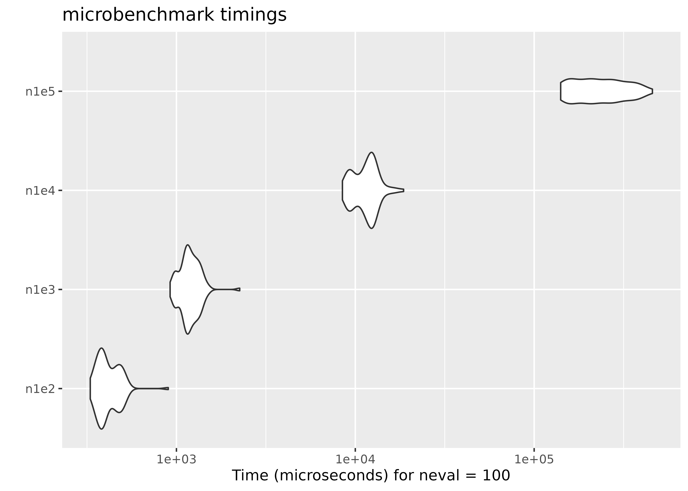
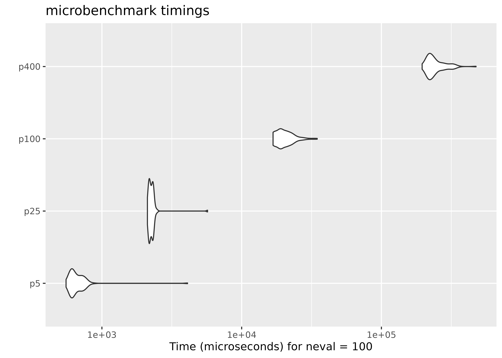

# Performance

All the tests were done on an Arch Linux x86_64 machine with an Intel(R)
Core(TM) i7 CPU (1.90GHz).

## Empirical likelihood computation

We show the performance of computing empirical likelihood with
[`el_mean()`](https://docs.ropensci.org/melt/reference/el_mean.md). We
test the computation speed with simulated data sets in two different
settings: 1) the number of observations increases with the number of
parameters fixed, and 2) the number of parameters increases with the
number of observations fixed.

## Increasing the number of observations

We fix the number of parameters at $`p = 10`$, and simulate the
parameter value and $`n \times p`$ matrices using
[`rnorm()`](https://rdrr.io/r/stats/Normal.html). In order to ensure
convergence with a large $`n`$, we set a large threshold value using
[`el_control()`](https://docs.ropensci.org/melt/reference/el_control.md).

``` r

library(ggplot2)
library(microbenchmark)
set.seed(3175775)
p <- 10
par <- rnorm(p, sd = 0.1)
ctrl <- el_control(th = 1e+10)
result <- microbenchmark(
  n1e2 = el_mean(matrix(rnorm(100 * p), ncol = p), par = par, control = ctrl),
  n1e3 = el_mean(matrix(rnorm(1000 * p), ncol = p), par = par, control = ctrl),
  n1e4 = el_mean(matrix(rnorm(10000 * p), ncol = p), par = par, control = ctrl),
  n1e5 = el_mean(matrix(rnorm(100000 * p), ncol = p), par = par, control = ctrl)
)
```

Below are the results:

``` r

result
#> Unit: microseconds
#>  expr        min         lq        mean      median         uq        max neval
#>  n1e2    329.779    373.119    420.7715    397.9305    463.187    900.136   100
#>  n1e3    921.688   1101.880   1199.0181   1171.5285   1286.258   2258.592   100
#>  n1e4   8473.727   9854.802  11566.4575  11801.7110  12583.246  18621.428   100
#>  n1e5 140700.141 169914.902 242965.2317 218511.6955 297760.593 458304.368   100
#>  cld
#>   a 
#>   a 
#>   a 
#>    b
autoplot(result)
#> Warning: `aes_string()` was deprecated in ggplot2 3.0.0.
#> ℹ Please use tidy evaluation idioms with `aes()`.
#> ℹ See also `vignette("ggplot2-in-packages")` for more information.
#> ℹ The deprecated feature was likely used in the microbenchmark package.
#>   Please report the issue at
#>   <https://github.com/joshuaulrich/microbenchmark/issues/>.
#> This warning is displayed once per session.
#> Call `lifecycle::last_lifecycle_warnings()` to see where this warning was
#> generated.
```



## Increasing the number of parameters 

This time we fix the number of observations at $`n = 1000`$, and
evaluate empirical likelihood at zero vectors of different sizes.

``` r

n <- 1000
result2 <- microbenchmark(
  p5 = el_mean(matrix(rnorm(n * 5), ncol = 5),
    par = rep(0, 5),
    control = ctrl
  ),
  p25 = el_mean(matrix(rnorm(n * 25), ncol = 25),
    par = rep(0, 25),
    control = ctrl
  ),
  p100 = el_mean(matrix(rnorm(n * 100), ncol = 100),
    par = rep(0, 100),
    control = ctrl
  ),
  p400 = el_mean(matrix(rnorm(n * 400), ncol = 400),
    par = rep(0, 400),
    control = ctrl
  )
)
```

``` r

result2
#> Unit: microseconds
#>  expr        min          lq        mean     median          uq        max
#>    p5    553.792    602.5295    691.4419    631.082    710.9605   4100.036
#>   p25   2116.321   2181.9940   2284.0509   2246.298   2326.4580   5700.480
#>  p100  16772.314  18709.1085  20476.7596  19148.461  22508.0570  34720.593
#>  p400 195609.790 216853.0250 246086.5816 233943.801 266540.6065 475479.869
#>  neval cld
#>    100 a  
#>    100 a  
#>    100  b 
#>    100   c
autoplot(result2)
```



On average, evaluating empirical likelihood with a 100000×10 or 1000×400
matrix at a parameter value satisfying the convex hull constraint takes
less than a second.
